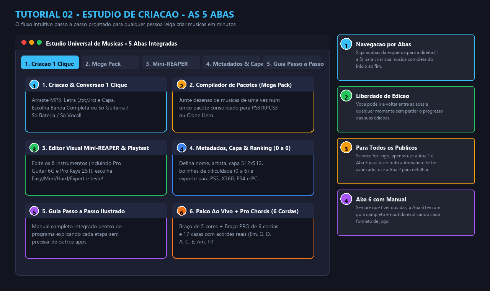

# 🎸 MidGuitar - Universal Rock Band & MIDI Studio

<div align="center">


**O estúdio MIDI definitivo para transformar qualquer instrumento musical de Rock Band e Guitar Hero em controladores MIDI profissionais para PC.**

[](https://www.python.org/)
[](https://microsoft.com)
[](https://www.midi.org/)
[](https://github.com/TomSchimansky/CustomTkinter)
[](LICENSE)

</div>

---

## 🎯 Sobre o Projeto

O **MidGuitar Studio** é uma central universal de instrumentos MIDI desenvolvida para conectar, mapear e executar em tempo real qualquer instrumento musical do ecossistema de jogos (com saídas MIDI físicas DIN de 5 pinos ou via USB/MIDI Pro Adapter):

1. 🎸 **Fender Squier Stratocaster (Rock Band 3 Pro Guitar)**: Guitarra real com cordas de verdade, captação e saída MIDI física de 5 pinos.
2. 🎸 **Fender Mustang PRO-Guitar (Rock Band 3)**: Guitarra com 102 botões clicáveis no braço (6 cordas x 17 trastes), 6 sensores de corda palhetáveis e saída MIDI de 5 pinos.
3. 🎹 **Rock Band 3 Wireless Keyboard**: Teclado/Keytar com 25 teclas sensíveis à velocidade (C3 a C5), fita touch ribbon (pitch bend/modulação) e saída MIDI física.
4. 🥁 **Baterias Eletrônicas Band Hero / Guitar Hero World Tour / 5 / Rock Band**: Baterias com saída MIDI física de 5 pinos transmitindo percussão com sensibilidade a força (Velocity) no **Canal MIDI 10**.
5. 🎮 **Guitarras Clássicas Rock Band / Guitar Hero (5 Botões)**: Conectadas via MIDI Pro Adapter (Mad Catz) ou receptores USB diretos.

---

## 📸 Guia Visual Passo a Passo (Tela por Tela)

> **Novo por aqui ou quer ver exatamente como criar e exportar músicas sem complicação?**  
> Acesse o nosso **[📖 TUTORIAL VISUAL ILUSTRADO (TUTORIAL_VISUAL.md)](TUTORIAL_VISUAL.md)**!  
> Ele contém ilustrações em alta definição de cada uma das telas do aplicativo, badges explicativos passo a passo (1, 2, 3...) e dicas para leigos e veteranos.

[](TUTORIAL_VISUAL.md)

---

## 🎵 Estúdio Criador & Conversor de Músicas (Rock Band 3, Rock Band 2, Pro Guitar & Keys, PS3, Xbox 360 & Clone Hero)

O MidGuitar conta com um **Estúdio Completo Integrado** que reúne num só app as etapas que antes exigiam várias ferramentas da comunidade (REAPER, Magma v2, C3 CON Tools e Onyx). Ele ainda **não** substitui essas ferramentas em tudo: os pacotes gerados foram conferidos com pacotes reais, mas ainda não foram testados tocando nos jogos. Veja o [status por destino](#-status-por-destino-o-que-já-foi-verificado) abaixo.

### ⏳ Como era o Processo Antigo vs 🚀 Como é Agora com o MidGuitar

| Etapa | Processo Antigo (Sofrimento com 4 programas) | Como é com o MidGuitar (Tudo em 1 App) |
| :--- | :--- | :--- |
| **Criação de Notas & Dificuldades** | Tinha que abrir o **REAPER**, configurar templates MIDI cheios de pistas e colocar **nota por nota à mão** durante dias para cada dificuldade. | **✨ Auto-Chart Inteligente:** Arraste o MP3 e crie todas as notas para **Guitarra, Baixo, Bateria, Teclado, Pro Guitar (6 cordas), Pro Bass, Pro Keys (25 teclas) e Vocais em 1 clique** nas **4 dificuldades (Easy, Medium, Hard e Expert)**, ou edite visualmente no **Mini-REAPER integrado**. |
| **Modo PRO (Pro Guitar / Pro Keys)** | Mapear `PART REAL_GUITAR` (6 cordas x 17 casas com velocidades MIDI 100..117) e `PART REAL_KEYS_X/H/M/E` no REAPER exigia semanas de trabalho técnico. | **🎸🎹 Geração e Edição PRO Nativa:** Gera automaticamente acordes reais de 6 cordas (Power Chords, barre chords e solos com números de casas) e tríades/melodias reais de 25 teclas (C3..C5) em todas as 4 dificuldades! |
| **Mecânica de Vocais & Regra Sem Letra** | Tinha que mapear manualmente notas de afinação (Pitch 36-84), marcadores de frase (Nota 105) e digitar cada sílaba. Sem letra, gerava notas mudas quebradas. | **🎤 Suporte Total a Vocais (.txt / .lrc / .srt):** Arraste ou cole a letra/legenda (`.txt`, `.lrc` ou `.srt`) para habilitar o microfone e sincronizar sílabas! **Se não houver letra, o Microfone fica desativado automaticamente (`vocal_parts 0`)**. |
| **Áudio Multitrack `.mogg` Oficial** | Tinha que usar ferramentas externas para injetar o cabeçalho binário Harmonix `0x0A` no OGG Vorbis, senão a música ficava muda no PS3/Xbox. | **🔊 Gerador `.mogg` (`0x0A`) Nativo Integrado:** Converte qualquer MP3/WAV/FLAC em `.mogg` não-criptografado com tabela de seek a cada 20.000 samples, no mesmo formato dos pacotes reais (ainda não testado tocando no jogo). |
| **Conversão Multi-Plataforma** | Precisava de **Magma v2**, **C3 CON Tools** ou **Onyx** para converter entre jogos e consoles. | **⚡ Exportação pelo próprio app:** gera pacotes para **Rock Band 3 (PS3/RPCS3 `BLUS30463`)**, **Xbox 360 (CON `45410914`)** e **Clone Hero / YARG**, conferidos com pacotes reais mas **ainda não testados no jogo**. **Rock Band 2** (PS3 `BLUS30147` / Xbox 360 `45410869`) é **não verificado**, **PS4 / Rock Band 4** é **experimental** (ainda não toca no RB4) e **GHWT:DE** não é suportado. Veja o [status por destino](#-status-por-destino-o-que-já-foi-verificado). |
| **Compilar Várias Músicas (Packs)** | Tinha que mesclar textos de `songs.dta` manualmente ou usar empacotadores com menus confusos em inglês. | **📦 Compilador de Mega Pacotes:** Selecione uma pasta com dezenas de músicas e o app compila tudo em um **único `songs.dta` unificado** e organizado em `USRDIR/<pasta do pacote>/songs/`, como os pacotes PS3 reais. |
| **Capa do Álbum** | Tinha que redimensionar manualmente em editores de imagem para tamanhos exatos do console (320x176). | **🖼️ Tratamento Automático:** Suba qualquer JPG/PNG e o app gera o `ICON0.PNG` oficial para a XMB do PS3 e o `album.png` do Clone Hero. |
| **Instalação no RPCS3 (RB3 e RB2)** | Tinha que caçar a pasta oculta `dev_hdd0/game/BLUS30463` ou `BLUS30147` na mão dentro do Windows. | **🚀 Scripts de Instalação:** O app gera `INSTALAR_NO_RPCS3_AUTOMATICO.bat` (RB3) e `INSTALAR_NO_RB2_RPCS3.bat` (RB2) dentro da pasta, que procuram o RPCS3 nas pastas usuais e copiam a música (ou pedem o caminho). |

### ✅ Status por destino (o que já foi verificado)

"Formato verificado" quer dizer que os testes automáticos comparam o que o MidGuitar gera com pacotes reais de músicas da comunidade. "Testado no jogo" quer dizer que alguém abriu e tocou a música no jogo ou no emulador — isso **ainda não foi feito** para nenhum destino. O roteiro para testar está em **[docs/TESTE_NO_JOGO.md](docs/TESTE_NO_JOGO.md)**.

| Destino | Formato verificado | Testado no jogo |
| :--- | :--- | :--- |
| **Rock Band 3 — PS3 / RPCS3** (`.pkg`, `USRDIR`, `songs.dta`, `.mogg`, `.mid.edat`, `.png_ps3`) | ✅ Sim: idêntico byte a byte aos pacotes PS3 reais de referência | ⏳ Ainda não |
| **Rock Band 3 — Xbox 360** (pacote CON `45410914`) | ✅ Sim: conferido com uma CON real | ⏳ Ainda não |
| **Clone Hero / YARG** (pasta com `song.ini` e `notes.mid`) | ✅ Sim: importar e exportar uma música real não perde dados | ⏳ Ainda não |
| **Rock Band 2** (PS3 `BLUS30147` / Xbox 360 `45410869`) | ❌ Não verificado (sem pacote de referência) | ⏳ Ainda não |
| **PlayStation 4 / Rock Band 4** | ⚠️ Experimental: só a estrutura de arquivos; ainda não toca no RB4 | ❌ Não |
| **GHWT:DE** (`.pak.xen` / `.fsb.xen`) | ❌ Não suportado (nem importa, nem exporta) | — |

---

### 🌟 As 5 Abas do Estúdio Criador

1. **⚡ Criação Rápida (MP3 + Letra) & Conversor 1 Clique (Central de Automação Modular)**:
   - **Opção A (Criar do Zero):** Arraste seu arquivo `.mp3`, sua letra/legenda opcional (`.txt`, `.lrc`, `.srt`) e capa (`.png`/`.jpg`) e clique em **GERAR TUDO AUTOMATICAMENTE**!
   - **Modos Solo Individuais e Kits Rápidos:** Selecione `⚡ Banda Completa`, `🎸 Kit RB2/GH` ou gere **APENAS 1 instrumento específico** com 1 clique: `🎸 Só Guitarra`, `🎸 Só Baixo`, `🥁 Só Bateria`, `🎹 Só Teclado`, `🎸 Só Pro Guitar`, `🎸 Só Pro Bass`, `🎹 Só Pro Keys` ou `🎤 Só Vocal`!
   - **Opção B (Importar de Fãs):** Aponte para qualquer pasta de música baixada (Chorus Encore, RhythmVerse, C3) para converter ou **Completar Instrumentos Faltantes** sem apagar as trilhas originais!
   - Exporte para **Rock Band 3 (RPCS3/PS3)**, **Xbox 360 (`45410914`)** e **Clone Hero / YARG** (formatos verificados, ainda não testados no jogo) e para **Rock Band 2 (PS3/RPCS3 `BLUS30147` & Xbox 360 `45410869`, sem as trilhas Pro/Keys que o RB2 não conhece — não verificado)**. A opção **PlayStation 4 (Rock Band 4)** é experimental e não verificada: gera só a estrutura de arquivos, ainda não toca no RB4. Mods do **GHWT:DE** usam outro formato (`.pak.xen`/`.fsb.xen`) e ainda não são suportados.
2. **📦 Compilador de Pacotes em Lote (Multi-Músicas PS3/CH)**:
   - Escaneia pastas com dezenas de músicas e compila todas juntas em um **Mega Pacote com um único `songs.dta` consolidado**, gerando `PARAM.SFO`, `ICON0.PNG` e instalador automático de 1 clique.
3. **🎛️ Editor Visual de Notas (Mini-REAPER, Modo PRO, Auto-Chart & Simulador de Playtest)**:
   - Linha do tempo visual estilo DAW para todos os 8 instrumentos: **Guitarra (5 Casas)**, **Baixo**, **Bateria**, **Teclado**, **Pro Guitar (6 Cordas com número da casa `0..17` visível)**, **Pro Bass**, **Pro Keys (25 Teclas com notas `C4`, `E4`, `G4`)** e **Vocais**.
   - Seletor de **Dificuldade (`Expert`, `Hard`, `Medium`, `Easy`)** para inspecionar, editar ou tocar qualquer nível individualmente.
   - **🔊 Simulador de Playtest (Estilo Magma / C3 Visualizer):** Ao tocar a música, as notas da dificuldade escolhida piscam nas casas e tocam o som automaticamente em tempo real!
   - **🎤 Sincronizador de Letra e Legenda (`.txt` / `.lrc` / `.srt`)**: Divisor silábico automático oficial Rock Band Network, download de modelo `.txt` de exemplo e trava inteligente (*Sem Letra = Sem Microfone*).
   - **🎮 Barra de Toque & Teste Interativo**: Toque junto com a música usando o teclado do PC (`A, S, J, K, L + Espaço`), microfone, controle/joystick ou instrumentos USB/MIDI reais plugados!
4. **🖼️ Metadados, Capa, Ranking de Dificuldade (0 a 6) & Exportação**:
   - Cadastro completo de Título, Artista, Álbum, Ano, Gênero e Charter, **seletor de Ranking de Dificuldade (0 a 6 bolinhas no padrão Magma/C3) para cada instrumento** (com cálculo automático), upload/geração automática de capa 512x512 e exportação direta.
5. **📖 Guia Passo a Passo (Para Leigos)**:
   - Tutorial ilustrado passo a passo cobrindo criação em 1 clique, modo PRO, importação, edição e instalação em todos os jogos e consoles.

---

## ✨ Principais Funcionalidades

- ⚡ **Detecção Automática de Instrumento (Auto Mode)**:
  - O aplicativo escuta as mensagens e comuta automaticamente o visualizador e a resposta sonora para o instrumento que estiver tocando:
    - Bateria no Canal 10 ➔ Ativa visualizador de Bateria e sintetizador de percussão GM.
    - Notas nos Canais 1 a 6 que formam uma casa válida da corda (0 a 22) ➔ Ativa visualizador de Guitarra Pro (6 cordas polifônicas + Pro Chords).
    - Teclas de C3 a C5 no Canal 1 ➔ Ativa visualizador de Teclado. Uma nota abaixo do Mi4 (64) no canal 1 não existe na Pro Guitar, então o app reconhece o teclado e continua nele até chegar uma nota nos canais 2 a 6.
    - 5 Casas clássicas (48-55 / 60-67) e palhetada (69 / 71 / 72) do MIDI Pro Adapter em outros canais ➔ Ativa visualizador de 5 botões com sistema de acordes.

- 🎛️ **Visualizadores Gráficos Especializados em Tempo Real**:
  - **Guitarra Pro & Pro Chords**: Desenho em alta precisão do braço com 6 cordas (E, A, D, G, B, E), 17 trastes clicáveis, painel interativo de **Pro Chords (`Em`, `G`, `D`, `A`, `C`, `E`, `Am`, `F`)** e **Palheta PRO**, indicando exatamente a corda tocada, a casa apertada e a nota resultante.
  - **Teclado (25 Teclas)**: Teclas brancas e pretas que acendem dinamicamente e medidor vertical da fita de toque (Touch Strip / Modulação).
  - **Bateria Eletrônica**: 6 pads (Bumbo Kick 36, Caixa Snare 38, Chimbal Hi-Hat 42/46, Tom 1 48, Surdo 41, Pratos Crash/Ride 49/55) com medidor de força (Velocity) e contador de toques.
  - **Guitarra 5 Botões**: Cores clássicas (Verde, Vermelho, Amarelo, Azul, Laranja), feedback de palhetada (Strum Up/Down) e alavanca (Whammy Bar).

- 🔊 **Motor de Áudio Híbrido e Flexível**:
  - **Síntese Nativa do Windows**: Toca imediatamente usando o Microsoft GS Wavetable Synth com 128 instrumentos General MIDI e o Kit de Bateria no Canal 10, sem necessidade de baixar pacotes externos.
  - **Roteamento para DAWs (Reaper, FL Studio, Amplitube, EZDrummer)**: Encaminha eventos em tempo real para portas virtuais (via [loopMIDI](https://www.tobias-erichsen.de/software/loopmidi.html)).

- 📂 **Presets de Afinação e Acordes Customizáveis**:
  - `Rock Power Chords`: Acordes de quinta prontos para tocar rock com a palheta.
  - `Pentatonic Solo`: Solos rápidos na escala pentatônica menor de Mi.
  - `Bass Groove`: Linhas de baixo elétrico com pegada encorpada.
  - `Pro Guitar Chromatic`: Transmissão direta sem quantização para DAWs e VSTs.

---

## 🛠️ Tecnologias Utilizadas

| Componente | Tecnologia | Finalidade |
|---|---|---|
| **Linguagem** | Python 3.9+ | Núcleo do sistema |
| **Comunicação MIDI** | `python-rtmidi` + `mido` | Leitura e envio de mensagens MIDI de altíssima velocidade e baixa latência |
| **Áudio Integrado** | `pygame.midi` (MMSystem) | Síntese de áudio nativa no Windows (Instrumentos + Percussão Canal 10) |
| **Interface de Usuário** | `customtkinter` | Interface escura, responsiva e moderna |
| **Empacotamento** | `pyinstaller` | Geração do executável `.exe` independente |

---

## 🚀 Como Usar o Executável (.exe)

1. Baixe ou acerte a pasta do executável em `dist/MidGuitar/`.
2. Conecte o cabo MIDI da sua guitarra, teclado ou bateria ao computador (usando interface USB-MIDI ou MIDI Pro Adapter).
3. Execute `MidGuitar.exe`.
4. Selecione a sua porta de entrada e clique em **Conectar**.
5. Toque qualquer instrumento! O aplicativo responderá visualmente e sonoramente na mesma hora.

---

## 💻 Como Rodar via Código Fonte (Desenvolvimento)

```powershell
# 1. Clonar o repositório
git clone https://github.com/gecclissi/MidGuitar.git
cd MidGuitar

# 2. Criar e ativar o ambiente virtual
python -m venv venv
.\venv\Scripts\activate

# 3. Instalar as dependências
pip install -r requirements.txt

# 4. Executar o estúdio
python src/main.py
```

---

## 📦 Como Compilar o Executável (.exe)

```powershell
python build_exe.py
```

O executável completo será gerado em:
```text
dist/MidGuitar/MidGuitar.exe
```

---

## 🎹 Especificações de Mapeamento MIDI dos Instrumentos

### 1. Guitarra Pro (Rock Band 3 Squier & Mustang)
A guitarra transmite em **um canal MIDI dedicado para cada corda**:
* **6ª Corda (Mi Grave / Low E):** Canal MIDI 6 (Nota base 40 / E2 + número do traste 0–17)
* **5ª Corda (Lá / A):** Canal MIDI 5 (Nota base 45 / A2 + número do traste 0–17)
* **4ª Corda (Ré / D):** Canal MIDI 4 (Nota base 50 / D3 + número do traste 0–17)
* **3ª Corda (Sol / G):** Canal MIDI 3 (Nota base 55 / G3 + número do traste 0–17)
* **2ª Corda (Si / B):** Canal MIDI 2 (Nota base 59 / B3 + número do traste 0–17)
* **1ª Corda (Mi Agudo / High E):** Canal MIDI 1 (Nota base 64 / E4 + número do traste 0–17)

### 2. Teclado Rock Band 3 (Keytar)
* **Teclas:** 25 teclas polifônicas sensíveis à velocidade transmitindo no **Canal MIDI 1** (C3 = Nota 48 até C5 = Nota 72).
* **Fita Touch Ribbon:** Control Change CC #1 (Modulação) e Pitch Bend.

### 3. Baterias (Band Hero / Guitar Hero / Rock Band Drums)
Transmitem exclusivamente no **Canal MIDI 10** (Percussão General MIDI):
* **Pedal de Bumbo (Kick):** Nota 36 (C1)
* **Pad Vermelho (Caixa / Snare):** Nota 38 (D1)
* **Pad Amarelo (Chimbal / Hi-Hat):** Nota 42 / 46 (F#1 / A#1)
* **Pad Azul (Tom 1 / Ride):** Nota 48 / 51
* **Pad Verde (Surdo / Crash 1):** Nota 41 / 49
* **Pad Laranja (Prato Splash / Crash 2):** Nota 55

---

## 🎛️ Integração com DAWs e VSTs Profissionais

1. Instale o driver virtual gratuito **[loopMIDI](https://www.tobias-erichsen.de/software/loopmidi.html)**.
2. Crie uma porta virtual chamada `MidGuitar Port`.
3. No **MidGuitar Studio**, selecione na **Saída de Áudio**: `[MIDI OUT] MidGuitar Port`.
4. Abra seu DAW preferido (Reaper, Ableton, FL Studio, Amplitube, EZDrummer, Superior Drummer, Kontakt) e selecione `MidGuitar Port` como entrada MIDI!

---

## 📄 Licença

Distribuído sob a licença **GNU GPL v3** (veja `LICENSE`). Partes do formato de pacotes (.mogg criptografado, CON/STFS do Xbox 360, .mid.edat e .pkg do PS3, capas png_xbox/png_ps3) foram portadas ou baseadas no [Onyx Music Game Toolkit](https://github.com/mtolly/onyx) de Michael Tolly (GPL v3) e conferidas contra pacotes reais; veja `CREDITS.md`.
