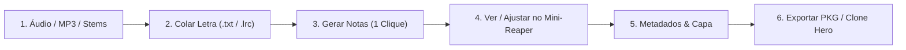
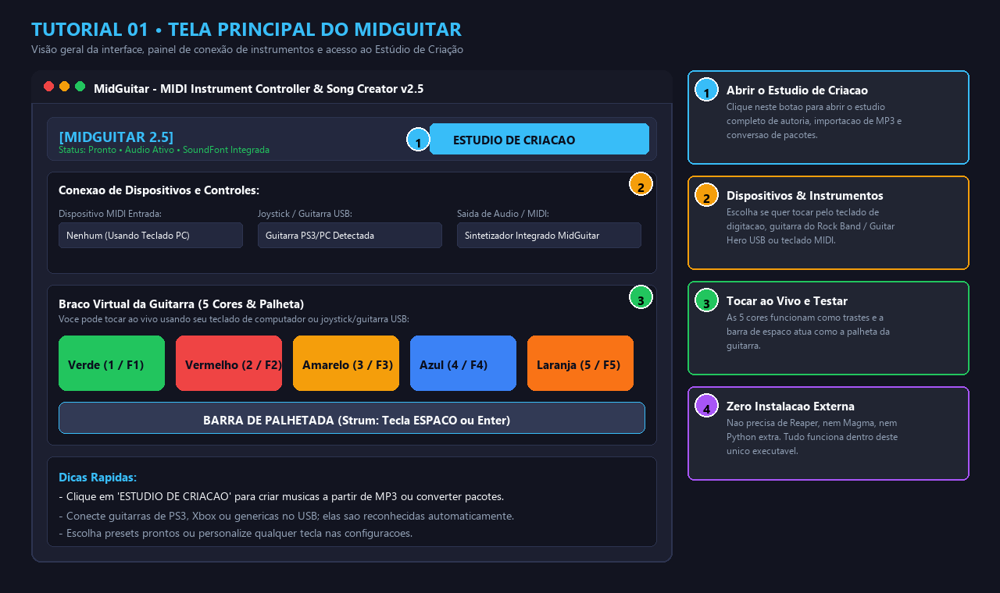
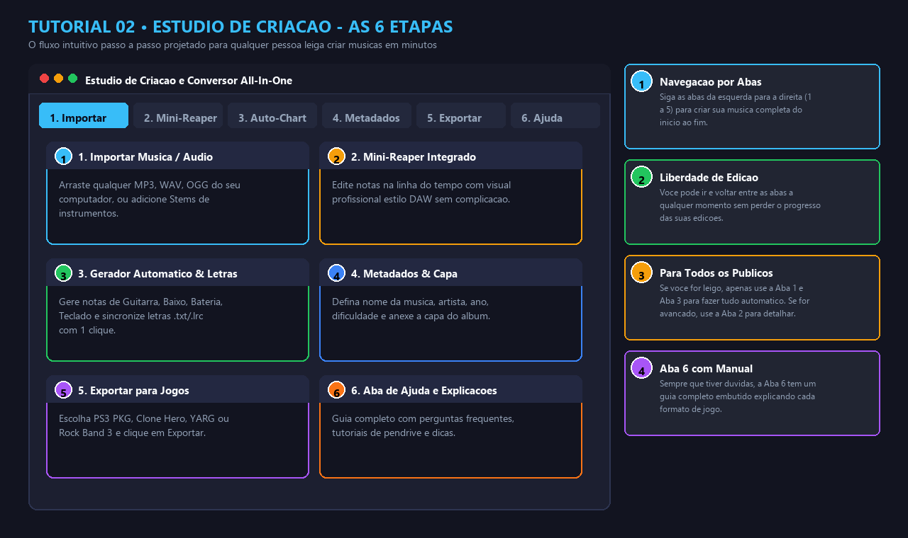
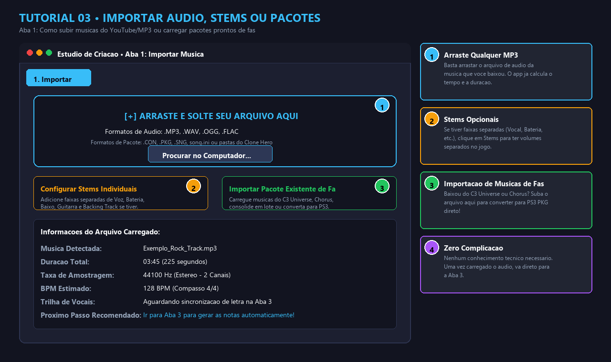
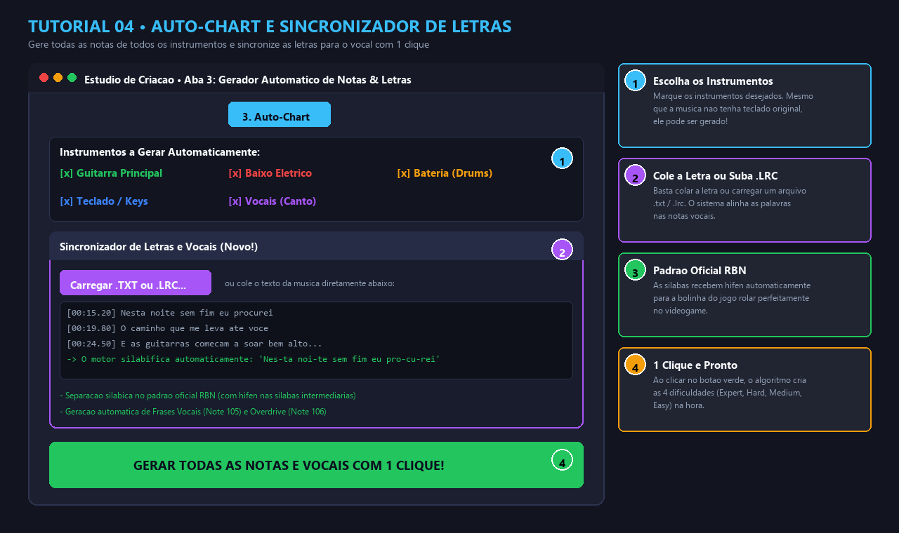
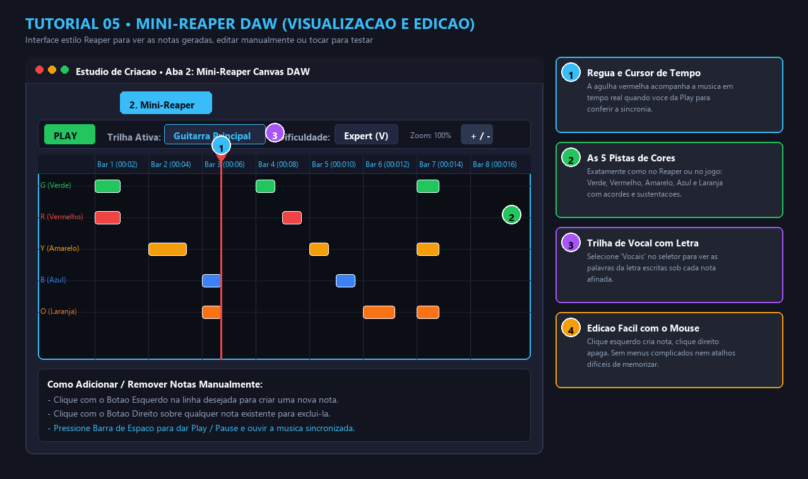
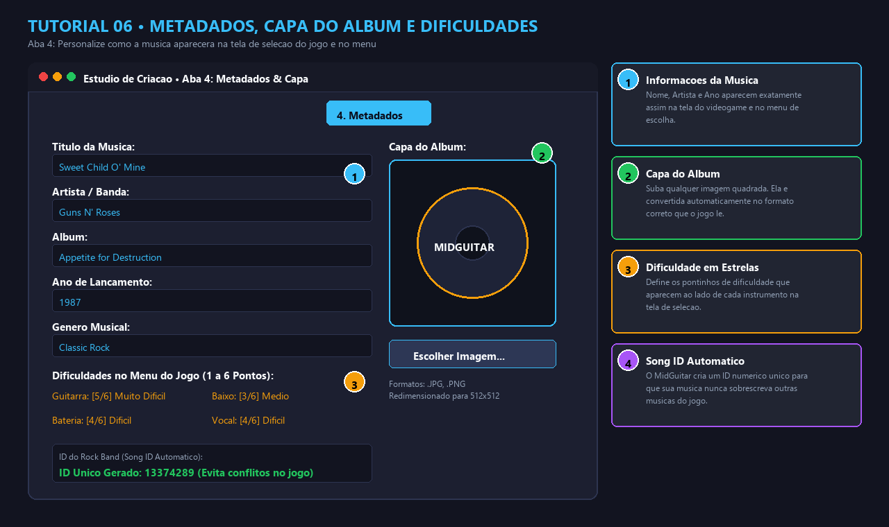
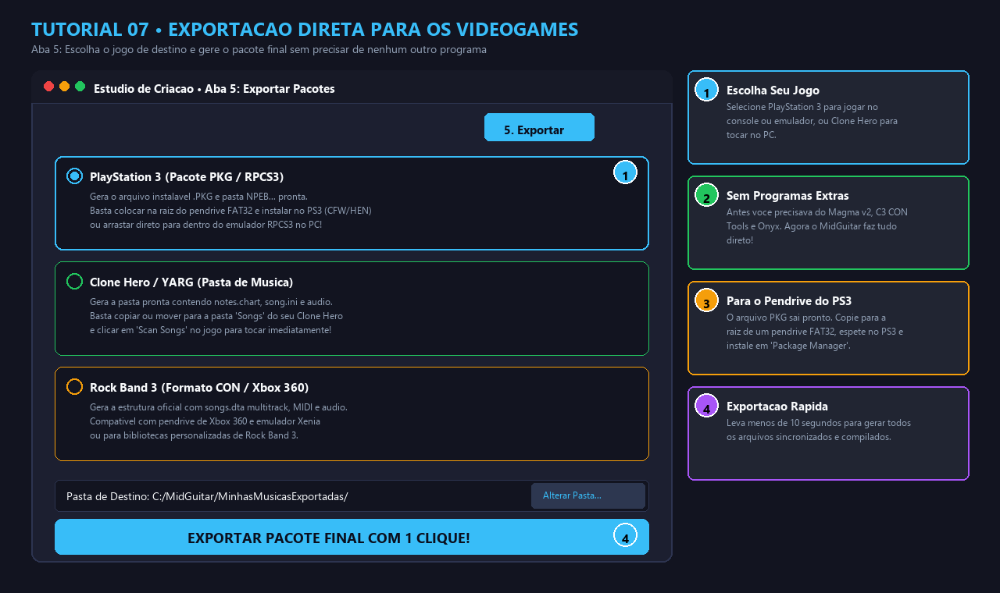
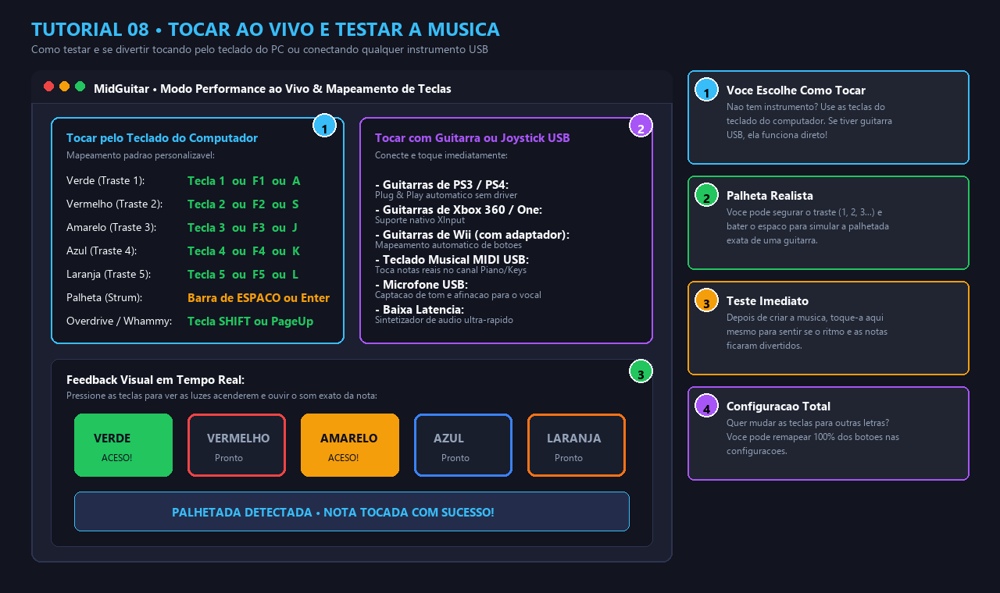

# 🎸 Guia Visual Passo a Passo • MidGuitar Studio

Este é o **Tutorial Visual Ilustrado** do **MidGuitar**, projetado para que **qualquer pessoa (mesmo leiga, sem conhecimento de música ou edição de áudio)** consiga criar, editar, testar e exportar músicas completas para **PlayStation 3 (Rock Band 3 / PKG)**, **Clone Hero / YARG** ou **PC**.

---

## 🗺️ Fluxograma do Processo

---

## 📸 1. Tela Principal e Acesso ao Estúdio

Na tela inicial do MidGuitar você tem acesso imediato aos controles ao vivo, instrumentos conectados e ao botão de abertura do estúdio de autoria.

### 📌 O que fazer nesta tela:
1. **[1] Botão ESTÚDIO DE CRIAÇÃO**: Clique no botão azul no topo direito para abrir o painel de criação e conversão de músicas.
2. **[2] Dispositivos Conectados**: Selecione seu teclado do PC, guitarra USB do Guitar Hero / Rock Band ou controlador MIDI.
3. **[3] Braço Virtual (Fretboard)**: As 5 cores clássicas (Verde, Vermelho, Amarelo, Azul e Laranja) e a barra de palhetada (*Strum*) para tocar ao vivo.

---

## 🗂️ 2. Navegação pelas 6 Etapas do Estúdio

O estúdio organiza todo o fluxo de trabalho em **abas ordenadas da esquerda para a direita**. Não há menus escondidos ou janelas confusas.

### 📌 As 6 Abas Explicadas:
* **Aba 1 (Importar)**: Suba o arquivo MP3/WAV da música ou pacotes prontos de fãs.
* **Aba 2 (Mini-Reaper)**: Veja todas as notas desenhadas no tempo, dê Play para ouvir e edite com o mouse se desejar.
* **Aba 3 (Auto-Chart & Letras)**: Gere as notas de todos os instrumentos e sincronize as letras automaticamente.
* **Aba 4 (Metadados & Capa)**: Insira o nome da música, artista, ano e imagem de capa do álbum.
* **Aba 5 (Exportar)**: Selecione seu jogo (PS3 PKG, Clone Hero, Rock Band 3) e clique em exportar.
* **Aba 6 (Ajuda)**: Manual integrado com respostas para dúvidas frequentes.

---

## 📂 3. Importando Música, Stems ou Pacotes Prontos

Para começar, basta fornecer o áudio da sua música.

### 📌 Como usar:
1. **[1] Arrastar e Soltar (Drag & Drop)**: Arraste qualquer arquivo `.MP3`, `.WAV`, `.OGG` ou `.FLAC` diretamente para a área indicada ou clique em **Procurar no Computador...**.
2. **[2] Stems Opcionais**: Se você tiver as faixas separadas da música (ex: só a voz, só a bateria, só a guitarra geradas em ferramentas de separação de áudio), clique em **Configurar Stems Individuais**. Se tiver apenas o MP3 estéreo comum, o MidGuitar adapta tudo automaticamente!
3. **[3] Importar Pacote de Fã**: Se você baixou músicas prontas do *C3 Universe*, *Chorus* ou de amigos e quer apenas converter para PS3 PKG, clique aqui e selecione o arquivo `.con`, `.sng` ou pasta do Clone Hero.

---

## ⚡ 4. Gerando Notas Automaticamente e Sincronizando Letras

O coração da automação do MidGuitar: gere notas para todos os instrumentos e alinhe a letra dos vocais em segundos.

### 📌 Passo a passo:
1. **[1] Selecionar Instrumentos**: Marque quais instrumentos você quer que existam na música:
   * Guitarra Principal
   * Baixo Elétrico
   * Bateria (*Drums*)
   * Teclado / Keys (*mesmo que a música não tenha teclado original, podemos gerar!*)
   * Vocais (Canto)
2. **[2] Colar Letra ou Carregar Arquivo**:
   * Clique em **Carregar .TXT ou .LRC...** para abrir a letra sincronizada.
   * Ou simplesmente **cole o texto da letra** no campo em branco.
3. **[3] Padrão Oficial RBN Automático**: O motor silabifica as palavras no padrão do Rock Band (com hífen nas sílabas intermediárias, ex: `Nes-ta noi-te`) e cria as marcações de frase vocal (*Note 105*) e overdrive vocal (*Note 106*).
4. **[4] Botão GERAR NOTAS**: Clique no botão verde inferior para criar todas as 4 dificuldades (*Expert, Hard, Medium, Easy*) de uma só vez!

---

## 🎵 5. Visualização e Edição no Mini-Reaper DAW

Uma linha do tempo estilo Reaper integrada para você inspecionar as notas criadas, fazer ajustes finos ou simplesmente ouvir a sincronia.

### 📌 Controles do Mini-Reaper:
* **[1] Cursor de Reprodução (Agulha Vermelha)**: Acompanha a música em tempo real quando você aperta o botão **PLAY** ou a **Barra de Espaço**.
* **[2] As 5 Pistas de Cores**: Verde, Vermelho, Amarelo, Azul e Laranja com suporte a notas simples, acordes e sustentações longas.
* **[3] Trilha de Vocais com Letra**: Alterne para a trilha **Vocais** para ver o texto de cada sílaba desenhado logo abaixo das notas cantadas.
* **[4] Edição Rápida com o Mouse**:
  * **Clique Esquerdo**: Cria uma nova nota na linha e tempo clicados.
  * **Clique Direito**: Exclui a nota clicada.
  * **Roda do Mouse / Teclas + e -**: Aumenta ou diminui o zoom da régua de compassos.

---

## 🏷️ 6. Metadados e Capa do Álbum

Personalize como a música aparecerá no menu do jogo e na tela de seleção do videogame.

### 📌 Campos disponíveis:
* **[1] Informações Principais**: Título da Música, Nome da Banda/Artista, Álbum, Ano de Lançamento e Gênero (Rock, Metal, Pop, etc.).
* **[2] Capa do Álbum**: Clique em **Escolher Imagem...** e selecione qualquer foto JPG ou PNG. O aplicativo redimensiona para 512x512 no padrão exigido pelo jogo.
* **[3] Dificuldade em Estrelas**: Defina de 1 a 6 a dificuldade que aparecerá ao lado do ícone de cada instrumento na tela de seleção do console.
* **[4] Song ID Único**: O MidGuitar gera automaticamente um identificador numérico exclusivo para garantir que a música nunca substitua outra música existente no seu videogame.

---

## 🚀 7. Exportação Direta para os Videogames

Escolha a plataforma de destino e gere o pacote final sem depender de nenhuma ferramenta antiga (como Magma, C3 CON Tools ou Onyx).

### 📌 As Opções de Exportação:
1. **🎮 PlayStation 3 (Pacote .PKG / RPCS3)**:
   * Gera o arquivo `.pkg` instalável e a pasta `NPEB...`.
   * **Como instalar no PS3 Real:** Copie o arquivo `.pkg` para a raiz de um pendrive formatado em FAT32. Conecte no PS3 (com CFW ou HEN ativado), vá no menu *Package Manager -> Standard* e instale com 1 clique!
   * **Como jogar no RPCS3 (Emulador de PC):** Arraste o arquivo `.pkg` para a janela do emulador e confirme a instalação.
2. **🎸 Clone Hero / YARG (Pasta de Música)**:
   * Gera a pasta com `notes.chart` (ou `notes.mid`), `song.ini` e o arquivo de áudio.
   * Copie a pasta para o diretório `Songs` do Clone Hero e clique em *Settings -> Scan Songs* dentro do jogo.
3. **💿 Rock Band 3 (Formato CON / Xbox 360)**:
   * Gera a estrutura de arquivos oficial com `songs.dta`, MIDI multitrack e áudio. Compatível com consoles Xbox 360 e emulador Xenia.

---

## 🎸 8. Modo Performance ao Vivo e Teste com Guitarra ou Teclado

Depois de criar a música (ou a qualquer momento), você pode tocar ao vivo usando seu teclado de computador ou conectando instrumentos USB reais!

### 📌 Formas de Jogar e Testar:

#### A) Pelo Teclado do Computador (Sem Instrumentos Externos)
* **Traste Verde:** Tecla `1` ou `F1` ou `A`
* **Traste Vermelho:** Tecla `2` ou `F2` ou `S`
* **Traste Amarelo:** Tecla `3` ou `F3` ou `J`
* **Traste Azul:** Tecla `4` ou `F4` ou `K`
* **Traste Laranja:** Tecla `5` ou `F5` ou `L`
* **Palhetada (*Strum*):** Barra de `ESPAÇO` ou tecla `ENTER`
* **Overdrive / Whammy:** Tecla `SHIFT` ou `PageUp`

> **Dica de Palheta Realista:** Você pode segurar as teclas de cores e apertar a barra de espaço para simular exatamente o movimento de palhetar uma guitarra real!

#### B) Com Guitarras e Controles USB
* **Guitarras de PS3 / PS4 (Guitar Hero / Rock Band):** Conecte o dongle USB no computador; o Windows e o MidGuitar reconhecem na hora!
* **Guitarras de Xbox 360 / Xbox One:** Reconhecimento automático via padrão XInput.
* **Guitarras de Nintendo Wii:** Compatíveis através de adaptador USB (como Raphnet ou V3).
* **Teclados Musicais MIDI:** Conecte via cabo USB-MIDI e toque diretamente na escala do sintetizador.
* **Microfones USB:** Captação de afinação e sensibilidade para o canal vocal.

---

## 💡 Dicas de Ouro para Iniciantes

1. **Quer criar rápido?** Arraste o MP3 na Aba 1, vá para a Aba 3, cole a letra (opcional), clique em **Gerar Notas** e na Aba 5 clique em **Exportar**. Pronto em menos de 1 minuto!
2. **O jogo aceita MP3 comum sem Stems?** Sim! O MidGuitar ajusta o arquivo de configuração `songs.dta` automaticamente para tocar músicas estéreo comuns sem travar o console.
3. **Errou alguma nota?** No Mini-Reaper (Aba 2), clique com o botão direito na nota para apagá-la ou com o botão esquerdo para reposicioná-la.
