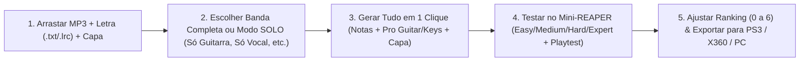
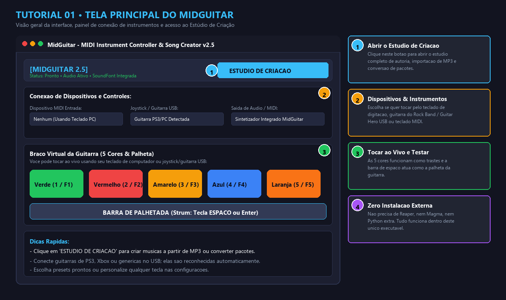
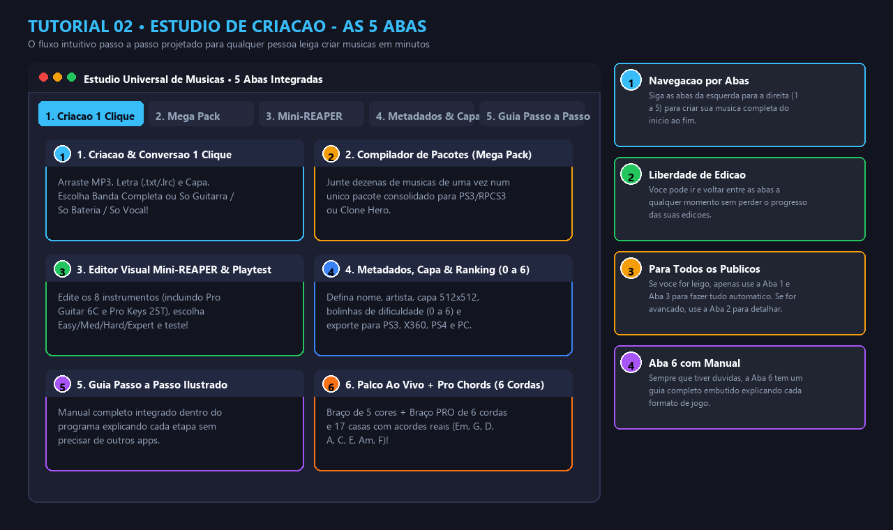
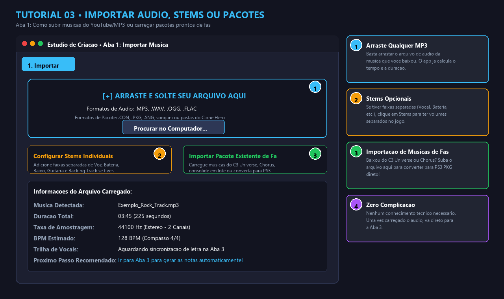
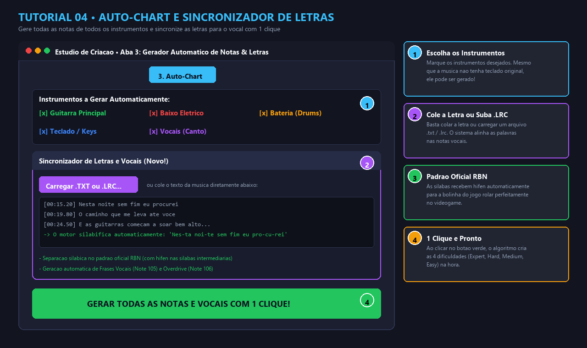
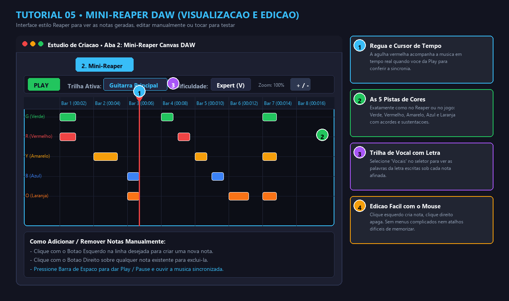
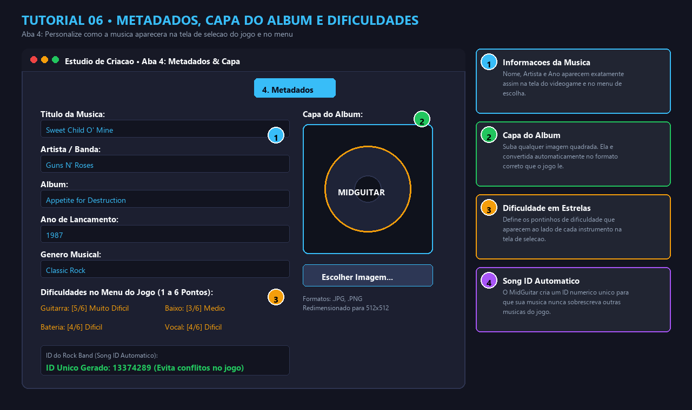
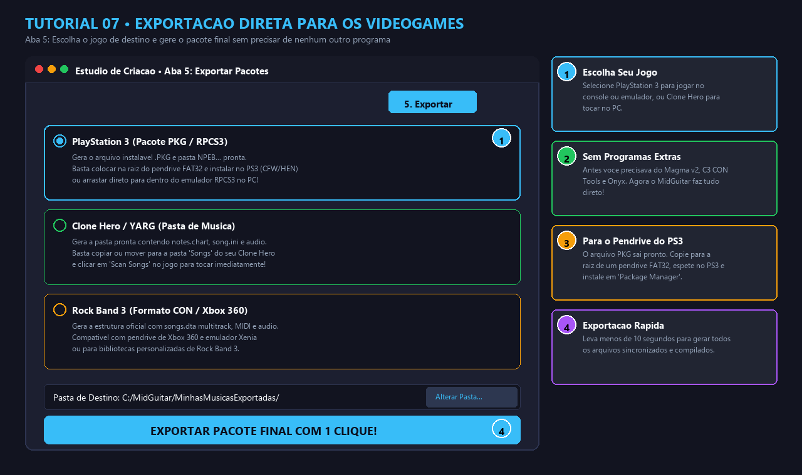
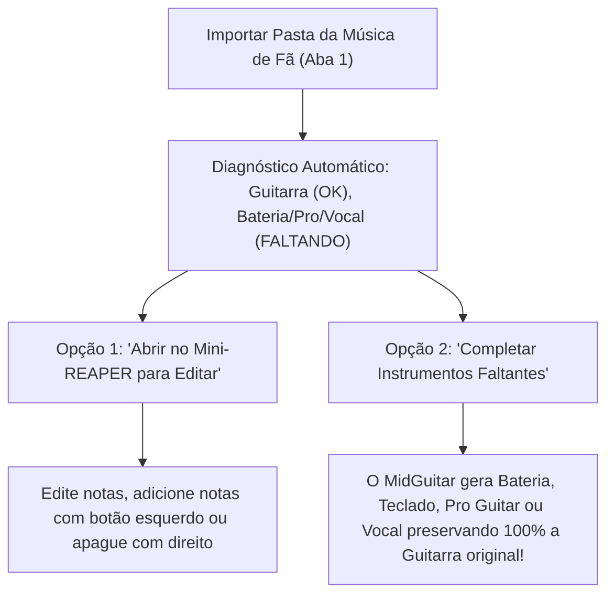

# 🎸 Guia Visual Passo a Passo • MidGuitar Universal Studio

Este é o **Tutorial Visual Ilustrado** do **MidGuitar**, projetado para que **qualquer pessoa (mesmo leiga, sem conhecimento de música ou edição de áudio)** consiga criar, editar, testar (Playtest) e exportar músicas completas para **PlayStation 3 (Rock Band 3 & Rock Band 2)**, **Xbox 360 (Rock Band 3 & Rock Band 2)**, **PC (Clone Hero / YARG)**. (A opção PlayStation 4 / Rock Band 4 é experimental e não verificada: ainda não toca no RB4.)

---

## 🗺️ Fluxograma Completo do Processo (Do Zero até o Videogame)

---

## 📸 1. Tela Principal: Palco Ao Vivo (5 Cores + Modo PRO Guitar & Pro Chords)

Na tela inicial do MidGuitar você tem acesso imediato aos controles ao vivo, instrumentos conectados, modo **5 Botões Clássico**, modo **PRO Guitar (6 Cordas, 17 Casas e Acordes Reais / Pro Chords)** e ao botão de abertura do **Estúdio de Criação**.

### 📌 O que fazer nesta tela:
1. **[1] Botão ESTÚDIO DE CRIAÇÃO**: Clique no botão roxo no topo direito para abrir o Estúdio Universal de criação, edição e conversão de músicas.
2. **[2] Alternador de Visualização (`🎸 Modo 5 Botões (Clássico)` vs `🎸 Modo PRO Guitar (6 Cordas + Acordes Reais)`)**:
   * **Modo 5 Botões**: Exibe as 5 cores clássicas (Verde, Vermelho, Amarelo, Azul e Laranja) e a barra de palhetada (*Strum*).
   * **Modo PRO Guitar & Pro Chords**: Exibe o braço completo de **6 cordas reais (E, A, D, G, B, e)**, casas `0 a 17`, botões rápidos de **Pro Chords (`Em`, `G`, `D`, `A`, `C`, `E`, `Am`, `F`)** com diagrama de trastes e **Palheta PRO**.
3. **[3] Dispositivos Conectados**: Use seu teclado do PC, guitarra USB do Guitar Hero / Rock Band, controle (joystick), bateria ou controlador MIDI.

---

## 🗂️ 2. Navegação pelas 5 Abas do Estúdio Universal

O estúdio organiza todo o fluxo de trabalho em **5 abas claras e diretas**, substituindo completamente programas complexos como *REAPER + RBN2 Tools*, *Magma v2*, *C3 CON Tools*, *EOF* e *Onyx*:

### 📌 As 5 Abas Explicadas:
* **⚡ Aba 1 — Criação & Conversão 1 Clique (Central de Automação Modular)**: Arraste seus arquivos (`.mp3`, `.txt`/`.lrc`, `.png` ou pastas de fãs), escolha quais instrumentos gerar (Banda Completa, Kit RB2/GH ou **Modo Solo de qualquer instrumento**) e gere ou exporte tudo na mesma tela!
* **📦 Aba 2 — Compilador de Pacotes (Mega Pack)**: Junte 10, 50 ou 100 músicas de uma vez num único Mega Pack consolidado para PS3/RPCS3 ou Clone Hero.
* **🎛️ Aba 3 — Editor Visual de Notas (Mini-REAPER) & Playtest**: Veja e edite as notas de todos os 8 instrumentos (`Guitarra`, `Baixo`, `Bateria`, `Teclado`, `Pro Guitar 6 Cordas`, `Pro Bass 4 Cordas`, `Pro Keys 25 Teclas`, `Vocais`), alterne entre **Easy, Medium, Hard e Expert**, grave ao vivo ou use o **Simulador de Playtest**!
* **🖼️ Aba 4 — Metadados, Capa, Ranking (0 a 6) & Exportação**: Edite nome da música, artista, álbum, capa 512x512, **bolinhas de dificuldade de 0 a 6 para cada instrumento** (padrão Magma/C3) e exporte para o console desejado.
* **📖 Aba 5 — Guia Passo a Passo (Para Leigos)**: Manual ilustrado dentro do próprio programa.

---

## ⚡ 3. Aba 1: Central de Automação Modular e Botões "Só [Instrumento]" (Modo Solo)

Na **Aba 1**, você cria uma música do zero a partir de um simples MP3 (ou converte músicas baixadas da internet) com controle modular total:

### 📌 Como criar do zero (Automático ou Modular):
1. **[1] Arrastar e Soltar (Drag & Drop)**: Arraste seu arquivo `.mp3`/`.wav`/`.ogg`, a letra `.txt`/`.lrc`/`.srt` e a foto da capa `.png`/`.jpg` diretamente para a janela! O sistema detecta automaticamente o **Artista**, o **Título da Música**, a **Duração Real** e o **BPM**.
2. **[2] Checkboxes Individuais + Botões de Modo Rápido / Solo para TODOS os Instrumentos**:
   Você pode marcar manualmente qualquer combinação nas caixas de seleção ou clicar nos botões rápidos:
   * `⚡ Banda Completa`: Marca todos os 8 instrumentos (ideal para Rock Band 3).
   * `🎸 Kit RB2/GH`: Marca apenas Guitarra, Baixo, Bateria e Vocal (ideal para Rock Band 2 e Guitar Hero).
   * **Modos Solo Individuais (gera APENAS o instrumento escolhido e limpa os demais)**:
     * `🎸 Só Guitarra` | `🎸 Só Baixo` | `🥁 Só Bateria` | `🎹 Só Teclado`
     * `🎸 Só Pro Guitar` | `🎸 Só Pro Bass` | `🎹 Só Pro Keys` | `🎤 Só Vocal`
   * `❌ Limpar`: Desmarca tudo para seleção manual.
3. **[3] Letra da Música & Modelo `.txt`**:
   * Clique em **`🎤 2. Letra / Legenda`** para colar a letra da internet ou clique em **`📄 Baixar Exemplo .TXT`** para ver o modelo com estrofes separadas.
4. **[4] Botão `✨ 3. GERAR TUDO AUTOMATICAMENTE!`**:
   * Cria todas as notas nas 4 dificuldades (*Expert, Hard, Medium, Easy*), calcula os rankings de dificuldade (0 a 6) e gera uma **Capa Neon 512x512 automática** caso você não tenha enviado foto!

---

## 🎛️ 4. Aba 3: Editor Visual Mini-REAPER, 4 Dificuldades e Simulador de Playtest

Na **Aba 3**, você visualiza, testa e edita cada detalhe da música sem precisar de plugins externos:

### 📌 Recursos do Mini-REAPER Integrado:
* **[1] Seletor dos 8 Instrumentos**: Alterne entre `🎸 Guitarra (5 Casas)`, `🎸 Baixo`, `🥁 Bateria`, `🎹 Teclado`, `🎸 Pro Guitar (6 Cordas)`, `🎸 Pro Bass`, `🎹 Pro Keys (25 Teclas)` e `🎤 Vocais`.
  * Nas trilhas **Pro Guitar / Pro Bass**, cada bloco mostra o **número real do traste (`0` a `17`)** na corda correspondente!
  * Na trilha **Pro Keys**, cada bloco mostra a **nota musical exata (`C4`, `E4`, `G4`)**!
  * Na trilha **Vocais**, cada nota exibe a **sílaba cantada** logo abaixo da barra de afinação!
* **[2] Seletor de Dificuldade (`🟢 Easy`, `🟡 Medium`, `🔴 Hard`, `🌟 Expert`)**:
  * Escolha qual dificuldade deseja ver, editar ou testar ao vivo!
* **[3] Simulador de Playtest (`🔊 Simular Som das Notas (Playtest)`)**:
  * Ao clicar em **`▶️ Tocar Música`**, o cursor vermelho percorre a música e o estúdio **pisca automaticamente os botões das casas e toca o som de cada nota** da dificuldade escolhida (igual ao *Magma / C3 Visualizer*), permitindo que você toque junto no teclado do PC, guitarra USB, controle ou microfone!
* **[4] Gravação ao Vivo (`🔴 INICIAR GRAVAÇÃO AO VIVO`)**:
  * Toque no teclado do PC (`A, S, J, K, L` + `Espaço`) ou no seu instrumento USB enquanto a música rola para gravar notas em tempo real!

---

## 🏷️ 5. Aba 4: Metadados, Capa 512x512 e Ranking de Dificuldade (0 a 6)

Personalize como a música aparecerá no menu do jogo (exatamente como no *Magma v2* e *C3 CON Tools*):

### 📌 Campos disponíveis na Aba 4:
* **[1] Informações Principais**: Título da Música, Artista/Banda, Álbum, Ano, Gênero, Autor do Chart e tempo de início da prévia de áudio (`preview_start_ms`).
* **[2] Ranking de Dificuldade por Instrumento (`0 a 6`)**:
  * Escolha manualmente de `0 (Sem Trilha)` até `6 (Impossível 🔥)` para **Guitarra, Baixo, Bateria, Teclado, Vocais, Pro Guitar, Pro Keys e Banda**, ou clique em **`✨ Calcular Automático`** para que o sistema calcule pelas notas da música!
* **[3] Capa do Álbum Automática ou Personalizada**:
  * Carregue qualquer imagem `.PNG` ou `.JPG` (convertida automaticamente para `512x512` e para texturas `.png_ps3` / `.png_xbox`). Se não tiver imagem, o MidGuitar gera uma capa profissional automaticamente!

---

## 🚀 6. Exportação Direta para Todos os Videogames e PC

Você pode exportar tanto pela **Aba 1** quanto pela **Aba 4** sem precisar baixar e reimportar arquivos entre abas — a música fica na memória do estúdio pronta para qualquer plataforma!

### 📌 Plataformas e Jogos Suportados:
1. **🎸 Rock Band 3 — PlayStation 3 (Console HEN/CFW & Emulador RPCS3)**:
   * Gera a estrutura completa `BLUS30463/USRDIR/` com `PARAM.SFO`, `ICON0.PNG`, `songs.dta` (com suporte a Pro Guitar, Pro Bass e Pro Keys), `.mid`, `.mogg` e `.png_ps3`, além do instalador `INSTALAR_NO_RPCS3_AUTOMATICO.bat`.
2. **🎸 Rock Band 2 — PlayStation 3 & Xbox 360 (BLUS30147 / RB2 Deluxe)**:
   * Gera pacote exclusivo com `songs.dta` no formato clássico (`format 4`) e **filtra automaticamente do arquivo MIDI as trilhas exclusivas do RB3** (`PART KEYS`, `PART REAL_GUITAR`, `PART REAL_BASS`, `PART REAL_KEYS`), garantindo 100% de compatibilidade sem travar o Rock Band 2!
3. **🟢 Xbox 360 — Rock Band 3 & Rock Band 2 (Console RGH/JTAG, Pendrive Horizon & Emulador Xenia)**:
   * Gera a estrutura `Content/0000000000000000/45410914/` (RB3) ou `45410869/` (RB2) com textura `.png_xbox` com cabeçalho HMX legítimo.
4. **🔵 PlayStation 4 — Rock Band 4 (EXPERIMENTAL, não verificado)**:
   * Gera só a estrutura de arquivos (`songs.dta`, `.mid`, `.mogg`, `project.gp4`). O RB4 exige arquivos binários (`.rbmid_ps4`, `.songdta_ps4`, `.moggsong`, `.png_ps4`) que o MidGuitar ainda não gera: **isto ainda não toca no Rock Band 4**.
5. **🎮 PC — Clone Hero / YARG**:
   * Gera a pasta pronta com `song.ini`, `notes.mid`, `album.png` (512x512) e `song.ogg`.
   * Os mods do *Guitar Hero World Tour: Definitive Edition* (`.pak.xen`/`.fsb.xen`) usam outro formato: **não são gerados nem importados**.

---

## 🛠️ 7. Como Editar Músicas de Fãs e Gerar Apenas Instrumentos Faltantes

Baixou uma música criada por outro fã do *Chorus Encore*, *C3 Universe* ou *RhythmVerse* que só tinha Guitarra, mas não tinha Bateria, Teclado, Pro Guitar ou Vocais?

---

## 🎯 8. As 4 Dificuldades Canônicas do Rock Band / Guitar Hero

| Nível de Dificuldade | Cores / Casas Utilizadas | Ritmo e Acordes | Descrição Oficial |
| :--- | :--- | :--- | :--- |
| **🟢 Fácil (Easy)** | **Apenas 3 cores:** Verde, Vermelha e Amarela. Quase nenhum azul, **zero laranja**. | **NUNCA acordes!** Estritamente notas individuais nos tempos fortes (semínimas/mínimas). | Ritmo calmo e espaçado (mínimo 380ms) para iniciantes. |
| **🟡 Médio (Medium)** | **4 cores:** Verde, Vermelha, Amarela e Azul. **Sem laranja** (transposta para azul). | Acordes duplos simples apenas nos tempos fortes. Ritmo moderado. | Não exige alcançar a casa laranja, permitindo um jogo fluido. |
| **🔴 Difícil (Hard)** | **Todas as 5 cores:** Verde, Vermelha, Amarela, Azul e Laranja. | Acordes duplos em várias posições. Solos rápidos simplificados para colcheias (8 avos). | Traz todas as 5 cores com velocidade desafiadora. |
| **🌟 Expert (Expert)** | **Todas as 5 cores** com HOPOs completos, solos em semicolcheias (16 avos) e acordes triplos. | Transcrição musical completa de 100% das notas da música. | O desafio máximo para mestres da guitarra, bateria e teclado. |
